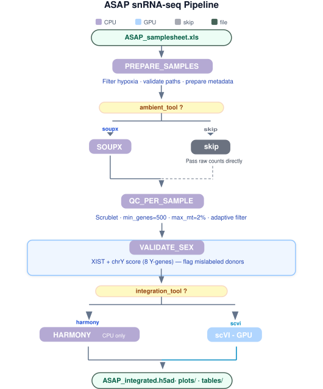

<p align="center">
  <a href="https://parkinsonsroadmap.org" target="_blank">
    
  </a>
  &nbsp;&nbsp;&nbsp;&nbsp;
  <a href="https://www.molecular-neurogenetics.lu.se/" target="_blank">
    
  </a>
</p>

# ASAP snRNA-seq Pipeline

Single-nucleus RNA-seq processing pipeline for the integration and sex-stratified analysis of ASAP CRN snRNA-seq cohorts.

---

## Project overview

This pipeline was developed as part of the **ASAP Multi-Omics Meta-Analysis (MoMa)** Collaborative Research Network project:

> **Chromosome Y Associated Transcriptional Variation in Parkinson's Disease**  

The pipeline processes single-nucleus RNA-seq data from post-mortem human brain samples (PD and neurologically healthy controls) contributed by multiple CRN teams. It performs ambient RNA correction, per-sample QC, automatic sex validation, and dataset integration. It is designed to produce a harmonized, male-only (or female-only, or combined) object suitable for downstream Y chromosome gene expression analysis.

**Input:** CellRanger output matrices + Excel samplesheet with donor metadata  
**Output:** Integrated AnnData object (`.h5ad`) + QC reports, UMAP plots, and sex validation heatmap

---

## Quick start

```bash
# Default: SoupX + Harmony, all samples
bash run.sh

# Resume after failure
bash run.sh -resume

# Skip ambient correction
bash run.sh --skip-ambient

# scVI integration (requires GPU node)
bash run.sh --scvi

# Males or females only
bash run.sh --males
bash run.sh --females

# Combine flags
bash run.sh --scvi --males -resume
```

---

## Parameters

| Parameter | Default | Options |
|---|---|---|
| `ambient_tool` | `soupx` | `soupx` · `skip` |
| `integration_tool` | `harmony` | `harmony` · `scvi` |
| `sex_filter` | `all` | `all` · `M` · `F` |
| `extra_filter` | *(none)* | `"col:val1,val2;col2:val3"` |
| `max_parallel` | `8` | any int |

Edit `EXTRA_FILTER` directly in `run.sh` to subset by region, condition, etc.

---

## System requirements & dependencies

### Compute

| Step | CPUs | RAM | Walltime | Node type |
|---|---|---|---|---|
| PREPARE_SAMPLES | 2 | 16 GB | 30 min | CPU |
| SOUPX | 4 | 24 GB | 2 h | CPU |
| QC_PER_SAMPLE | 4 | 24 GB | 1 h | CPU |
| VALIDATE_SEX | 2 | 64 GB | 30 min | CPU |
| INTEGRATE_HARMONY | 16 | 100 GB | 12 h | CPU (sens-xl) |
| INTEGRATE_SCVI | 8 | 64 GB | 6 h | **GPU** (Ampere) |

The pipeline has been tested on:
- SLURM HPC cluster (COSMOS-SENS, LUNARC, Lund University)
- Verily Workbench (GCP) via the ASAP CRN Workbench spend pod `asap-crn-gcp`

### Software

All dependencies are containerised. The versions below reflect what is pinned in the Dockerfiles.

| Tool | Version | Container | Notes |
|---|---|---|---|
| Nextflow | ≥ 23.10 | — | workflow orchestration |
| Singularity / Apptainer | ≥ 3.8 | — | container runtime (`--nv` for GPU) |
| Python | 3.11 | `scrnaseq_sif` | QC, sex validation, Harmony integration |
| Python | 3.12 | `scvitools_sif` | required by scvi-tools 1.5.x |
| Python | 3.11 | `cellbender_sif` | ambient correction (GPU, pending module) |
| scanpy | 1.10.2 | `scrnaseq_sif`, `scvitools_sif`, `cellbender_sif` | |
| anndata | 0.10.8 | `scvitools_sif`, `cellbender_sif` | not pinned in `scrnaseq_sif` |
| harmonypy | 0.0.10 | `scvitools_sif` | also present unpinned in `scrnaseq_sif` |
| scrublet | unpinned | `scrnaseq_sif` | doublet detection |
| scvi-tools | 1.5.1 | `scvitools_sif` | GPU integration |
| PyTorch | 2.2.0+cu121 | `scvitools_sif` | |
| PyTorch | 2.1.2+cu121 | `cellbender_sif` | |
| CUDA | 12.1 | `scvitools_sif`, `cellbender_sif` | driver ≥ 530.30.02 required |
| CellBender | 0.3.0 | `cellbender_sif` | pending module — replaces SoupX at scale |
| R / Seurat | satijalab/seurat:latest | `rocker_sif` | base image; version not pinned |
| SoupX | unpinned | `rocker_sif` | ambient correction |
| DESeq2 / edgeR / limma | Bioconductor release | `rocker_sif` | available for downstream DE |
| clusterProfiler | Bioconductor release | `rocker_sif` | available for downstream GSEA |
| numpy | 1.26.4 | `scvitools_sif`, `cellbender_sif` | pinned to numpy 1.x ABI (torch 2.x requirement) |

> Container images are available as Docker images on DockerHub (see [Containers](#containers) below).  
> Only the versions listed above have been tested. The `scrnaseq_sif` and `rocker_sif` containers do not pin all package versions; exact resolved versions are recorded in the container build logs.

### Input data

The pipeline requires CellRanger-generated count matrices (raw and filtered `feature_bc_matrix`). Data are not included in this repository. ASAP CRN members can access the harmonized snRNA-seq cohort (`prod-cohort-pmdbs-sc-rnaseq`) via [cloud.parkinsonsroadmap.org](https://cloud.parkinsonsroadmap.org).

---

## Installation

```bash
# Clone the repository
git clone https://github.com/paudbr2002/ASAP_snRNAseq_wf.git
cd ASAP_snRNAseq_wf

# Pull containers (Singularity)
singularity build scrnaseq.sif     docker://pdeblas/scrnaseq:latest
singularity build rocker.sif       docker://pdeblas/rocker:latest
singularity build scvitools.sif    docker://pdeblas/scvitools:1.5.1-gpu
singularity build cellbender.sif   docker://pdeblas/cellbender:0.3.0-gpu  # pending module

# Update container paths in nextflow.config
nano nextflow.config
```

Verify the installation by running the pipeline on the provided test samplesheet:

```bash
bash run.sh --males  # uses test data from /test/
```

---

## Pipeline steps



### 1 · PREPARE_SAMPLES
Reads the Excel samplesheet, drops `hypoxia == 1`, applies `extra_filter`, and validates that every `matrix_path` exists on disk.  
**Output:** `samples_valid.csv`, `samples_missing.txt`

### 2 · SOUPX *(CPU · rocker_sif · 4 cpu · 24 GB · 2h)*
Ambient RNA correction via [SoupX](https://github.com/constantAmateur/SoupX).  
`load10X()` → `autoEstCont()` → `adjustCounts(roundToInt=TRUE)`.  
Tracks Y-gene counts before/after correction (`y_counts_raw`, `y_counts_corrected`) for mLOY QC.  
Falls back to uncorrected matrix if `raw_feature_bc_matrix` is missing.  
**Output:** `{sid}_soupx/` (MTX), `{sid}_soupx_report.csv`

### 3 · QC_PER_SAMPLE
Per-sample quality control with scanpy + scrublet.

| Filter | Threshold |
|---|---|
| Doublets | scrublet (predicted_doublet) |
| min genes | 500 |
| max MT% | 2.0% |
| Adaptive | mean ± 2 SD on n_genes |
| min nuclei | 50 (else → `.EXCLUDED`) |

Stores raw counts in `adata.layers["counts"]` before normalisation (required by scVI).  
**Output:** `{sample_id}.h5ad` or `{sample_id}.EXCLUDED`

### 4 · VALIDATE_SEX *(CPU · scrnaseq_sif · 2 cpu · 64 GB · 30 min)*
Computes XIST expression and a chrY gene score per donor using 8 Y-genes:  
`RPS4Y1 · DDX3Y · UTY · EIF1AY · KDM5D · ZFY · USP9Y · TMSB4Y`

| Flag | Condition |
|---|---|
| ♂ mislabeled | XIST > Q50(females) |
| ♀ mislabeled | chrY > Q75(males) **and** XIST < Q25(females) |

Flagged donors are excluded before integration.  
**Output:** `validated_samples.csv`, `excluded_samples.csv`, `heatmap_chrY_XIST_per_patient.png`

### 5a · INTEGRATE_HARMONY *(CPU · scrnaseq_sif · 16 cpu · 100 GB · 12h · sens-xl)*
`normalize_total(1e6)` → `log1p` → `HVG(3000)` → `PCA(30)` → Harmony → UMAP → Leiden.  
Batch key: `seqnum`. Sex added as correction key when `sex_filter=all`.

### 5b · INTEGRATE_SCVI *(GPU · scvitools_sif · 8 cpu · 64 GB · 6h · sens-gpu)*
scVI variational autoencoder on raw counts (`layers["counts"]`).  
`n_latent=30 · n_layers=1 · n_hidden=128 · NegBinom · dropout=0.1`  
`max_epochs=400 · early_stopping(patience=20) · batch_size=512`  
TF32 disabled (prevents NaN on Ampere GPUs).  
**Output:** `ASAP_integrated.h5ad` + `scvi_model/`

---

## Output structure

```
results_ASAP/
├── tables/
│   └── samples_valid.csv
├── ambient_reports/
│   └── {sid}_soupx_report.csv
├── per_sample_qc/
│   ├── {sid}.h5ad
│   └── {sid}.EXCLUDED
├── sex_validation/
│   ├── validated_samples.csv
│   ├── excluded_samples.csv
│   └── heatmap_chrY_XIST_per_patient.png
├── integration/
│   ├── ASAP_integrated.h5ad
│   ├── scvi_model/          ← only with --scvi
│   ├── plots/
│   └── tables/
├── pipeline_timeline.html
├── pipeline_report.html
└── pipeline_dag.html
```

---

## Repository structure

```
ASAP_snRNAseq_wf/
├── main.nf                  ← main Nextflow workflow
├── run.sh                   ← wrapper script (cluster submission)
├── nextflow.config          ← resource profiles and container paths
├── modules/
│   ├── prepare_samples.nf
│   ├── soupx.nf
│   ├── qc_per_sample.nf
│   ├── validate_sex.nf
│   ├── integrate_harmony.nf
│   └── integrate_scvi.nf
├── scripts/
│   ├── soupx.R
│   ├── qc_per_sample.py
│   ├── validate_sex.py
│   ├── integrate_harmony.py
│   └── integrate_scvi.py
├── test/
│   └── test_samplesheet.xlsx
├── pipeline_diagram.svg
└── README.md
```

---

## Containers

| Container | Used by | DockerHub image | Key contents |
|---|---|---|---|
| `scrnaseq_sif` | PREPARE_SAMPLES, QC_PER_SAMPLE, VALIDATE_SEX, HARMONY | `pdeblas/scrnaseq:latest` | Python 3.11, scanpy, harmonypy 0.0.10, scrublet, leidenalg |
| `rocker_sif` | SOUPX | `pdeblas/rocker:latest` | R + Seurat (satijalab base), SoupX, DESeq2, clusterProfiler |
| `scvitools_sif` | INTEGRATE_SCVI | `pdeblas/scvitools:1.5.1-gpu` | Python 3.12, scvi-tools 1.5.1, torch 2.2.0+cu121, CUDA 12.1 |
| `cellbender_sif` | INTEGRATE_CELLBENDER *(pending)* | `pdeblas/cellbender:0.3.0-gpu` | Python 3.11, CellBender 0.3.0, torch 2.1.2+cu121, CUDA 12.1 |

Singularity is run with `--nv` so GPU containers can access the host NVIDIA driver.  
Container paths are defined in `nextflow.config`.

To convert a Docker image to Singularity SIF:

```bash
singularity build scrnaseq.sif     docker://pdeblas/scrnaseq:latest
singularity build rocker.sif       docker://pdeblas/rocker:latest
singularity build scvitools.sif    docker://pdeblas/scvitools:1.5.1-gpu
singularity build cellbender.sif   docker://pdeblas/cellbender:0.3.0-gpu
```

---

## Limitations

- **Scale:** The pipeline has been tested on up to 146 samples (~272,000 nuclei). Performance at the full CRN scale (~3,000 samples) is extrapolated; the integration step is the bottleneck. Switch to `--scvi` (GPU) at that scale.
- **Ambient correction:** SoupX is strongly recommended over `--skip-ambient` for LOY studies. 
- **Sex validation requires both sexes:** The VALIDATE_SEX thresholds are computed from the distribution of both male and female donors in the input. 
- **GPU requirement:** `INTEGRATE_SCVI` requires an Ampere-generation GPU (or newer). TF32 is disabled to prevent NaN loss on Ampere hardware; this adds ~15% runtime overhead.
- **Short-read mapping:** Ampliconic and multi-copy Y genes cannot be uniquely mapped with short reads and are not reliably quantified by this pipeline.
- **Tested input format:** Only CellRanger v6/v7 output (MTX format) has been validated as input. Other formats may require preprocessing.

---

## Citation

If you use this pipeline, please cite:

For the in-house ASAP test dataset used for pipeline validation, please cite:

> Garza R, et al. (2026). [Title]. *Science Advances.* [DOI: to be added]

---


## Acknowledgements

This research was funded in whole or in part by Aligning Science Across Parkinson's [ASAP-030017] through the Michael J. Fox Foundation for Parkinson's Research (MJFF).

The pipeline was developed within the **ASAP CRN Multi-Omics Meta-Analysis (MoMa)** working group.  
Pipeline development: Paula de Blas Rioja & Yogita Sharma.  
Project design: Jakobsson's Team

---

